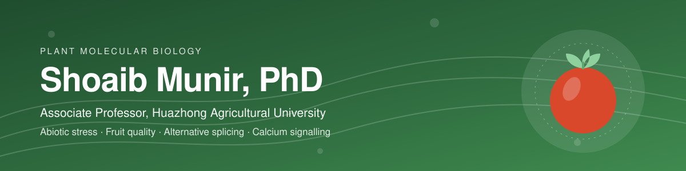

  
  
  
  
  
  
  
  

## About

Associate Professor at the **College of Horticulture & Forestry Sciences, Huazhong Agricultural University** (Wuhan, China). I study how horticultural crops, mainly tomato and pear, respond to abiotic stress, and what shapes fruit quality.

| | |
|---|---|
| 🌡️ **Abiotic stress** | Heat, drought and salinity responses, as a question of crop resilience under a changing climate |
| 🍅 **Fruit quality** | Tomato and other fruit crops, including nutritional quality and vitamin C (ascorbate) |
| 🧬 **Gene regulation** | Alternative splicing and how gene expression is reshaped under stress |
| 📡 **Calcium signalling** | Calmodulin-like (CML) proteins as candidate decoders of stress signals |

**Scholar metrics** (Google Scholar, 29 Sep 2026): 829 citations · h-index 13 · i10-index 15

## Publications

Selected from my [Google Scholar](https://scholar.google.com/citations?user=7bfl00wAAAAJ) and [ORCID](https://orcid.org/0000-0001-5248-6450) records. 20 peer-reviewed papers; my role is shown in bold.

### 2026
- **Corresponding author.** Pangenome-wide identification of chloroplast RNA splicing and ribosome maturation (CRM) genes in eight *Pyrus* genomes indicated their involvement in multiple stresses. *Scientific Reports*. [doi:10.1038/s41598-026-48265-0](https://doi.org/10.1038/s41598-026-48265-0)

### 2025
- **Co-first author.** Alternative splicing occurs in auxin-mediated trade-off between fruit development and quality in tomato. *BMC Plant Biology*. [doi:10.1186/s12870-025-07259-2](https://doi.org/10.1186/s12870-025-07259-2)
- Transcription factors SlBBX20 and SlMYB9 in tomato modulate plant height through gibberellin metabolic and response pathways. *Journal of Experimental Botany*. [doi:10.1093/jxb/eraf403](https://doi.org/10.1093/jxb/eraf403)
- *Botrytis cinerea* targets chloroplast to suppress photosynthesis and enhance susceptibility by attenuating degradation of SlBIUPa in tomato. *Plant, Cell & Environment*. [doi:10.1111/pce.70085](https://doi.org/10.1111/pce.70085)

<b>2013 – 2023</b> (16 papers)

#### 2023
- SlTCP24 and SlTCP29 synergistically regulate compound leaf development through interacting with SlAS2 and activating transcription of SlCKX2 in tomato. *New Phytologist*. [doi:10.1111/nph.19221](https://doi.org/10.1111/nph.19221)

#### 2022
- Cyclin gene SlCycB1 alters plant architecture in association with histone H3.2 in tomato. *Horticultural Plant Journal*. [doi:10.1016/j.hpj.2021.12.004](https://doi.org/10.1016/j.hpj.2021.12.004)
- Assessing salt tolerance induction in potato by salicylic acid using morpho-physio-biochemical, ionic, and yield indices. *Potato Research*. [doi:10.1007/s11540-021-09539-4](https://doi.org/10.1007/s11540-021-09539-4)

#### 2021
- Genome-wide identification and expression profiling of tomato invertase genes indicate their response to stress and phytohormones. *Journal of Plant Growth Regulation*. [doi:10.1007/s00344-021-10384-5](https://doi.org/10.1007/s00344-021-10384-5)
- Regulation of invertase and sucrose for improving tomato fruit flavor: a review. *Vegetable Research*. [doi:10.48130/VR-2021-0010](https://doi.org/10.48130/VR-2021-0010)
- Functional gain of fruit netted-cracking in an introgression line of tomato with higher expression of the FNC gene. *Frontiers of Agricultural Science and Engineering*. [doi:10.15302/J-FASE-2020374](https://doi.org/10.15302/J-FASE-2020374)

#### 2020
- **First author.** Genome-wide analysis of myo-inositol oxygenase gene family in tomato reveals their involvement in ascorbic acid accumulation. *BMC Genomics*. [doi:10.1186/s12864-020-6708-8](https://doi.org/10.1186/s12864-020-6708-8)
- **Co-first author.** Linking phytohormones with growth, transport activity and metabolic responses to cadmium in tomato. *Plant Growth Regulation*. [doi:10.1007/s10725-020-00580-w](https://doi.org/10.1007/s10725-020-00580-w)
- Altered brassinolide sensitivity1 transcriptionally inhibits chlorophyll synthesis and photosynthesis capacity in tomato. *Plant Growth Regulation*. [doi:10.1007/s10725-020-00650-z](https://doi.org/10.1007/s10725-020-00650-z)
- An allelic variant of GAME9 determines its binding capacity with the GAME17 promoter in the regulation of steroidal glycoalkaloid biosynthesis in tomato. *Journal of Experimental Botany*. [doi:10.1093/jxb/eraa014](https://doi.org/10.1093/jxb/eraa014)

#### 2019
- Biosynthetic gene pyramiding leads to ascorbate accumulation with enhanced oxidative stress tolerance in tomato. *International Journal of Molecular Sciences*. [doi:10.3390/ijms20071558](https://doi.org/10.3390/ijms20071558)
- Development of a highly specific co-dominant marker for genotyping the *Ph-3* (tomato late blight resistance) locus by comparing cultivated and wild ancestor species. *Molecular Breeding*. [doi:10.1007/s11032-019-0953-z](https://doi.org/10.1007/s11032-019-0953-z)

#### 2016
- **First author.** Overexpression of calmodulin-like (ShCML44) stress-responsive gene from *Solanum habrochaites* enhances tolerance to multiple abiotic stresses. *Scientific Reports*. [doi:10.1038/srep31772](https://doi.org/10.1038/srep31772)
- **First author.** Genome-wide identification, characterization and expression analysis of calmodulin-like (CML) proteins in tomato (*Solanum lycopersicum*). *Plant Physiology and Biochemistry*. [doi:10.1016/j.plaphy.2016.02.020](https://doi.org/10.1016/j.plaphy.2016.02.020)
- An ATL78-like RING-H2 finger protein confers abiotic stress tolerance through interacting with RAV2 and CSN5B in tomato. *Frontiers in Plant Science*. [doi:10.3389/fpls.2016.01305](https://doi.org/10.3389/fpls.2016.01305)

#### 2013
- Effect of drought stress on growth and flowering of marigold (*Tagetes erecta* L.). *Pakistan Journal of Botany* 45(S1): 123–131.

Full, up-to-date list: [Google Scholar](https://scholar.google.com/citations?user=7bfl00wAAAAJ) · [ORCID](https://orcid.org/0000-0001-5248-6450)

## Open tools

### 📚 [2026 Emerging Journals Database](https://github.com/bajwa82mna/journals2026)
A searchable database of **22,281 emerging journals** with Q1–Q4 quartile rankings across **21 disciplines** (2026 edition). Search by journal name or ISSN, filter by quartile or category, and sort by rank. It runs entirely in the browser, no backend needed.

**[Open the live database →](https://smbajwa.com/tools/emerging-journals-2026/)** · [Source on GitHub](https://github.com/bajwa82mna/journals2026)

## Service to the field

- Peer reviewer for **35 journals**, including *New Phytologist*, *Horticulture Research*, *BMC Plant Biology* and *Scientific Reports*.
- Co-organiser of international symposia and forums in horticultural plant biology (2017–2026).

## Contact

**Shoaib Munir, PhD** · Associate Professor
College of Horticulture and Forestry Sciences, Huazhong Agricultural University
Lion Mountain Street 1, Wuhan 430070, China

[LinkedIn](https://www.linkedin.com/in/shoaib-munir-phd-7b816b29/) · [X](https://x.com/bajwa82mna) · [Google Scholar](https://scholar.google.com/citations?user=7bfl00wAAAAJ) · [ORCID](https://orcid.org/0000-0001-5248-6450) · [Web of Science](https://www.webofscience.com/wos/author/record/J-7407-2015) · [Scopus](https://www.scopus.com/authid/detail.uri?authorId=45461323600) · [Frontiers Loop](https://loop.frontiersin.org/people/319922/overview)
